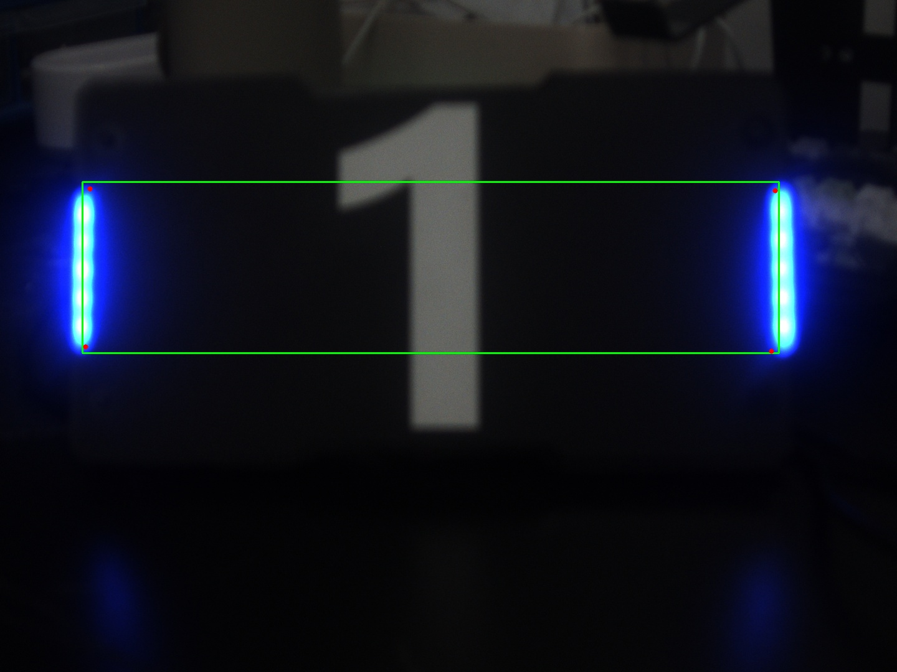

# RoboMaster 工业相机视觉作业

项目用 C++、海康 MVS 和 OpenCV 采集工业相机画面，通过 ONNX Runtime CUDA 运行 YOLO26n-pose，输出装甲板框、类别、分数和四个关键点。代码提供单图诊断、实时预览与录像，以及独立的相机性能和异常测试。

已提交真实工业相机的实时检测录像、检测截图和离线推理对照。四项相机实验的完整量化数据仍待实测，详见 [实验记录](EXPERIMENTS.md) 和 [错误处理记录](TROUBLESHOOTING.md)。

[实时检测演示视频（MP4，10 秒）](demo/armor_live.mp4)



## 环境和文件

- Linux x86-64、C++17、OpenCV C++ 开发包。运行窗口需要桌面和 OpenCV HighGUI，录像需要支持 MJPG 的 VideoIO 后端。
- 海康 MVS 头文件默认在 `/opt/MVS/include`，64 位库默认在 `/opt/MVS/lib/64`。可用 `MVS_INCLUDE_DIR`、`MVS_LIB_DIR` 覆盖路径。
- ONNX Runtime GPU 1.30.0，CUDA 13 和 cuDNN 9。当前机器已安装到 Python 3.14 的 `.venv`。可用 `ORT_SITE_PACKAGES`、`ORT_CAPI_DIR` 指向已有安装。匹配的 1.30.0 C++ 头文件和 MIT 许可证位于 `ort-include/`。
- 将社团提供权重导出的 `armor.onnx` 放在项目目录。模型需要 Ultralytics Pose 元数据、固定 FP32 输入和未经 NMS 的输出。报告使用的模型输出为 `[1,18,8400]`，类别 `B1、B2、B3、R1、R2、R3`，关键点为 `[4,2]`。权重另行准备。
- 单图测试需要相机抓图 `armor_test.bmp`。模型输入预处理为等比缩放、居中补灰、BGR 转 RGB、除以 255、NCHW 排列。框和关键点通过同一比例和补边偏移还原。

## 编译和运行

在项目目录运行：

```bash
pkg-config --modversion opencv4
export ORT_SITE_PACKAGES="$HOME/armor_linux/.venv/lib/python3.14/site-packages"
bash build.sh
bash run.sh infer_bmp armor.onnx armor_test.bmp 0.5 1.0
```

单图会保存 `armor_result_cpp.jpg` 和 `armor_model_input_cpp.jpg`。前者在原图上画预测，后者直接在送入模型的图上画预测，可用于区分模型定位与坐标还原问题。

先在 MVS 客户端设置好曝光、增益和 PixelFormat，再断开客户端连接，让程序接管唯一连接的 GigE 或 USB 相机：

```bash
mkdir -p runs
set -o pipefail
bash run.sh infer_live armor.onnx 10 0.5 1.0 2>&1 | tee runs/live.log
```

最后三个参数依次为录像秒数、相对模型画布的缩放倍率和软件亮度倍率。相机曝光和增益使用设备当前设置。按 Q 或 Esc 可提前停止。带标注的 `armor_live_*.avi` 按时间轴写入 15 FPS，终端另报实际处理 FPS。当前显示策略为单块装甲板调试，每帧画最高分候选并显示其分数，低分框也会显示。

相机性能和异常复现命令见实验记录。日志可能含相机序列号，公开提交前按作业要求确认序列号的披露方式。
